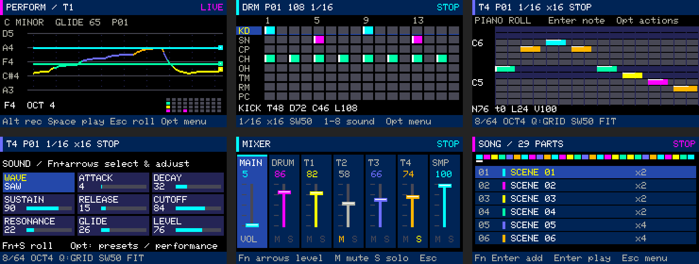
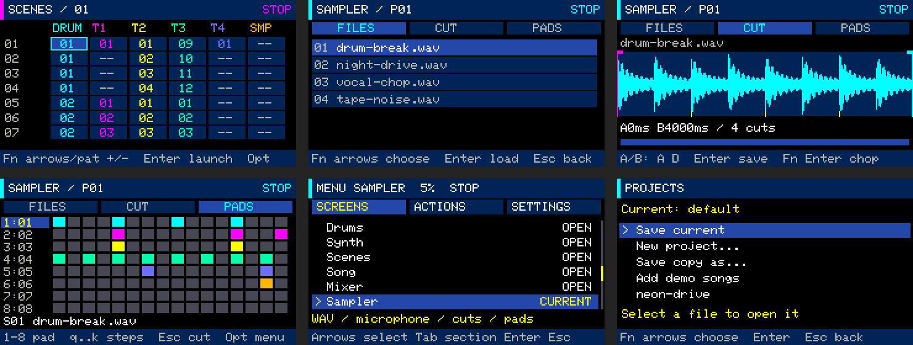
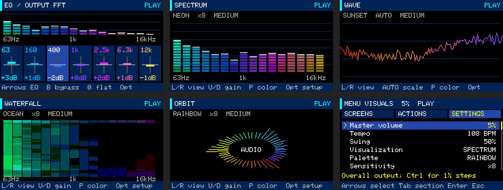

# Cardputer Groovebox — Synthesizer, Drum Machine & Sampler

A portable music workstation for **M5Stack Cardputer ADV (ESP32-S3)**. Make beats
with an eight-sound drum machine, play four synth tracks, slice WAV files or live
microphone recordings, and arrange patterns into complete songs. The physical
keyboard controls the step sequencer, piano roll and mixer; projects and source
audio live on microSD.

[Quick start](docs/quick-start.md) · [Controls](docs/controls.md) ·
[Documentation](docs/README.md) · [Demo projects](examples/README.md) ·
[Build and install](#build-and-install)



*Interface screenshots rendered with the device's UI drawing code, including its
RGB332 color palette. Individual screens are shown at 2× the native 240×135 size.*

## Make your first beat

1. Open **Opt → SCREENS → Quick start** for the built-in tutorial.
2. In **Drums**, choose a sound with `1..8`, then toggle steps with `qwertyui` /
   `asdfghjk`.
3. Press `Space` to play. Use `+` / `−` to adjust master volume.
4. Press `Fn+2`, then **Opt → ACTIONS → Performance** for the synth's string layout.
   Hold `Z`, press `X`, then release `X`: the note slides back to the held `Z`.
5. With the loop playing, press `Alt` to record notes and `Alt` again to finish.
6. Open **Opt → SCREENS → Projects** to save, create, copy or load a project.

`Opt` opens the menu; `Fn` is only a modifier. `Esc` goes back or cancels, and opens
the menu from a main workspace. [Follow the full first-track guide →](docs/quick-start.md)

## Features

| Workspace | What you can do |
|---|---|
| **Drum machine** | Sequence eight synthesized percussion sounds across 16 patterns, with 4/8/16 steps, accents and swing |
| **Synthesizer** | Play four tracks, record live notes, edit in the piano roll, and shape waveform, ADSR, filter, resonance and glide |
| **Performance** | Play four keyboard rows as strings, with legato, held-note return, root/scale selection, six presets and animated pitch trails |
| **Arpeggiator** | Turn live or recorded chords into Up, Down or UpDown patterns with rate, octave and gate controls |
| **Sampler** | Import WAV from microSD or record the microphone; select and chop waveforms into 32 sample slots for eight sequencer pads |
| **Scenes and Song** | Combine six tracks into 16 scenes and up to 64 song entries; minimap play markers and scrolling keep the playing row visible |
| **Mixer** | Set master and six track levels, with per-track mute and solo |
| **Audio visuals and RGB** | Seven-band master EQ with output FFT, spectrum/wave/waterfall/orbit modes, four palettes and audio-reactive LED |
| **Projects** | Create named `.gbp` files, autosave, keep a backup, save copies and reopen your last project |



The four synth tracks and live playing share **five synth voices**, reduced to four
while samples play. The sampler provides four playback voices and roughly
65 seconds of total decoded sample storage. Each synth pattern holds up to
64 notes. Projects are saved as GBP v6 and can be loaded from v1–v6; WAV audio is
referenced separately, so transfer the `samples` folder with your projects.

## Audio-reactive visuals

Press **Fn+7** for a seven-band audio equalizer with live output FFT, or **Fn+8** for four configurable
visualizations. Choose colors, sensitivity, smoothing and motion in SETTINGS.
Wave automatically fits quiet passages and loud peaks. The RGB LED follows instrument
and song audio with saturated, held colors and adjustable brightness.



Bare arrows navigate editors and menus; Performance preserves their musical keys.
The synth opens in Performance by default. [Visuals, controls and RGB details →](docs/audio-visuals.md)

## Synthwave, techno and drum and bass demo songs

**Projects → Add demo songs** installs seven original, complete arrangements without
overwriting existing files: three retrowave/synthwave, two techno and two drum and
bass tracks. Each uses 29 song entries and 16 scenes, with built-in drums and synths
and no external samples.

| Project | Style | Tempo / key | Length |
|---|---|---|---|
| [Neon Drive](examples/projects/neon-drive.gbp) | Driving retrowave bass, bright arpeggios and lead | 108 BPM / A minor | ≈3:02 |
| [Sunset Arcade](examples/projects/sunset-arcade.gbp) | Mellow synthwave with gentle swing | 92 BPM / D minor | ≈3:34 |
| [Midnight Run](examples/projects/midnight-run.gbp) | Faster night-drive synthwave | 122 BPM / E minor | ≈2:41 |
| [Circuit Pressure](examples/projects/circuit-pressure.gbp) | Acid-inspired techno with resonant bass | 132 BPM / A minor | ≈3:24 |
| [Concrete Pulse](examples/projects/concrete-pulse.gbp) | Percussive, industrial-inspired techno | 140 BPM / F minor | ≈3:12 |
| [Night Transit](examples/projects/night-transit.gbp) | Dark rolling drum and bass | 174 BPM / D minor | ≈3:19 |
| [Liquid Signal](examples/projects/liquid-signal.gbp) | Melodic liquid drum and bass | 170 BPM / G minor | ≈3:23 |

Load a demo, then press **Fn+4 → Enter** to play the song. Demos start at **5% master
volume**. [Listen to previews and explore the arrangements →](examples/README.md)

## Documentation

- [Quick start: make your first track](docs/quick-start.md)
- [Equalizer FFT, visualizations and RGB LED](docs/audio-visuals.md)
- [Menu navigation and settings](docs/menu.md)
- [Keyboard shortcuts and layouts](docs/controls.md)
- [Projects, saving and recovery](docs/projects.md)
- [Synth Performance, legato and sound presets](docs/synth-performance.md)
- [Live recording and piano roll editing](docs/stage-3.md)
- [Scenes, song arrangement, mixer and arpeggiator](docs/stage-4.md)
- [Sampler: WAV import, microphone recording and slicing](docs/stage-5-sampler.md)
- [Interface gallery and visual design review](docs/visual-refresh.md)
- [UX review and interaction decisions](docs/ux-review.md)

## Build and install

The supported hardware target is **M5Stack Cardputer ADV**. The firmware uses
ESP-IDF 5.5.1 and M5GFX 0.3.0. `tools/idf.sh` runs ESP-IDF in Docker; host tests
require a C++17 compiler, GNU make and Python 3.

```bash
git clone https://github.com/khurss/cardputer-groovebox.git
cd cardputer-groovebox
docker pull espressif/idf:v5.5.1
make test
python3 -m unittest discover -s tools -p 'test_*.py'
tools/idf.sh firmware build
```

For a device with this project's **Launcher / GLIDE / Groovebox partition layout**:

```bash
python3 tools/slot.py install-app firmware/build/groovebox.bin
```

The installer checks the partition table and writes Groovebox at `0x260000`,
preserving Launcher and GLIDE. The sampler cache occupies 4 MB at `0x3e0000`.
**Do not use `idf.py flash` with this layout:** it writes the bootloader and
partition table. If the installer rejects another layout, do not bypass its checks.
The SD card is not formatted. Place source WAV files in `/groovebox/samples/`.

## Validation

The repository includes host tests, audio renderers and automated hardware checks:

```bash
python3 tools/device_menu_test.py
python3 tools/device_ux_test.py
python3 tools/device_visual_test.py
python3 tools/device_audio_visual_test.py
python3 tools/device_sampler_test.py
```

Hardware checks use an isolated project and sample library with a **5% output
ceiling**. They restore the regular project and verify its checksums and backup.
See the [visual refresh report](docs/visual-refresh.md#validation-record) for recorded
results and the individual guides for feature-specific checks.

## Inspiration

The string layout and legato interaction are inspired by
[CHARL3X's GLIDE Synth for Cardputer ADV](https://github.com/CHARL3X/GLIDE-Synth-Cardputer-ADV).
Groovebox uses its own DSP, visuals and presets; it is an independent implementation.
