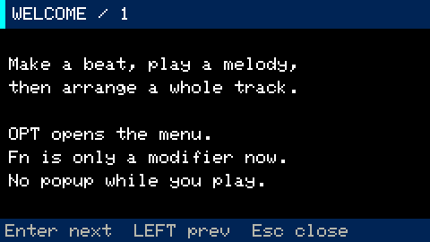

# Cardputer Groovebox documentation

Learn to make music on the **M5Stack Cardputer ADV**: program drums, record synth
parts, slice samples and arrange a complete song. Start with the on-device tutorial
at **Opt → SCREENS → Quick start**, or follow the illustrated guide below.

## User guides

| Guide | What it covers |
|---|---|
| [Quick start](quick-start.md) | Your first beat, melody, scene and song |
| [Menu](menu.md) | SCREENS, ACTIONS, SETTINGS and navigation |
| [Controls](controls.md) | Physical keys, shortcuts and piano/string layouts |
| [Projects](projects.md) | New, Save, Save copy, Open, autosave and recovery |
| [Synth Performance](synth-performance.md) | Strings, legato, pitch trails, scales and sound presets |
| [Synth recording and editing](stage-3.md) | Live recording, note editing, quantize and sound parameters |
| [Arrangement and mixer](stage-4.md) | Patterns → scenes → songs, levels and arpeggiation |
| [Audio visuals and RGB](audio-visuals.md) | Equalizer FFT, four animations, palettes and LED feedback |
| [Sampler](stage-5-sampler.md) | WAV import, live microphone recording, slicing and pads |
| [Demo songs](../examples/README.md) | Nine original synthwave, techno, hard techno and drum and bass projects with audio previews |

## Design and development

- [Interface gallery and visual refresh](visual-refresh.md)
- [UX review and interaction decisions](ux-review.md)
- [Build, installation and validation](../README.md#build-and-install)
- [Historical design specification](superpowers/specs/2026-11-09-groovebox-design.md)
- [Historical implementation plans](superpowers/README.md)

The screenshots in these guides are rendered from the application's UI drawing
commands with the device font and RGB332 palette, at 2× native resolution. They show
example states, not camera photographs or a running emulator. See the
[image index](images/README.md) for screen descriptions.

Implementation plans and their test counts describe the stage at which they were
written. Use the user guides for current controls and project behavior.
