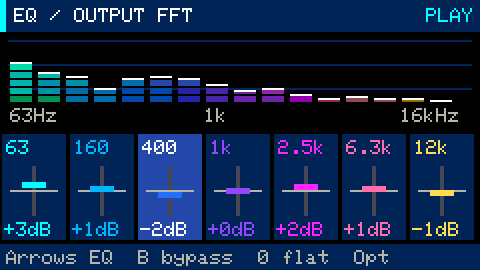
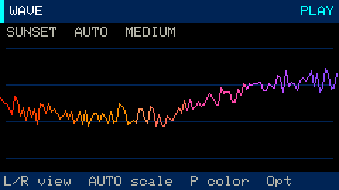

# Audio visuals, Equalizer FFT and RGB feedback

**Fn+7** opens **Equalizer FFT**. **Fn+8** opens **Visuals**. Both are also available
under **Opt → SCREENS** and in the eight-workspace Tab cycle.
[All guides](README.md) · [Keyboard controls](controls.md)


These views analyze the actual mixed output, including drums, synths and samples.
They respond to live playing as well as recorded scenes and songs. Master mute or
zero output produces silence in the analyzer; a synth's release remains visible
and audible after transport stops until the note fades out.

## Equalizer FFT



**Fn+7** replaces the former Mixer/FFT workspace with a real master audio EQ.
The ordinary channel mixer remains on **Fn+5**. All drums, synths and samples pass
through this EQ after channel mixing and before the limiter and MAIN volume.
The spectrum above it measures the final output, so it includes EQ, limiting,
master-volume changes and bypass.

| Band | Center frequency | Range |
|---|---|---|
| Sub/bass | 63 Hz | −12 to +12 dB |
| Bass | 160 Hz | −12 to +12 dB |
| Low mids | 400 Hz | −12 to +12 dB |
| Mids | 1 kHz | −12 to +12 dB |
| Presence | 2.5 kHz | −12 to +12 dB |
| Treble | 6.3 kHz | −12 to +12 dB |
| High treble | 12 kHz | −12 to +12 dB |

- **Left/right:** select a band. **Up/down:** change gain by 1 dB; Shift gives 3 dB.
- **B:** bypass/re-enable processing while keeping the gains for comparison.
- **0:** reset the selected band to 0 dB. **Shift+0:** reset all bands, keeping bypass state.
- **Fn+Z:** undo the last EQ or mixer edit, including a full reset.
- Plain **+ / −:** MAIN volume; Ctrl gives 1% steps. Space controls playback.
- **Opt → SETTINGS:** band, gain, bypass, palette, FFT sensitivity and RGB brightness.
  **ACTIONS** also offers bypass, reset and undo.

All seven gains start at 0 dB. Gains and bypass state are saved in **GBP v6 projects**,
including autosave, project copies and reloads. Projects from v1–v5 open with flat EQ.
The selected band is an editor cursor and is not saved. Old firmware that only
supports v5 cannot open a new v6 save. Bundled v5 demos remain compatible.

Each band is a fixed-center, Q=1 peaking biquad using the
[RBJ/W3C Audio EQ Cookbook coefficients](https://www.w3.org/TR/audio-eq-cookbook/).
Coefficient changes ramp over 512 samples (16 ms at 32 kHz); bypass uses a short
fade. The EQ uses fixed storage and does not allocate during rendering. The
existing output limiter and the 5% test ceiling remain after EQ. Large boosts can
engage the limiter, so the final output may increase less than the band setting.
This is a master EQ, shared by all tracks; it does not provide per-track EQ or
movable center frequencies. FFT **Sensitivity** only changes the display and LED
response; the band's **dB gain** changes the sound.

## Four visualizations

| Mode | Display |
|---|---|
| **Spectrum** | Sixteen colored frequency bands with segmented bars |
| **Wave** | An automatically scaled waveform with a rising-crossing trigger to reduce jitter |
| **Waterfall** | Recent spectrum history, with low frequencies on the left and newest data at the top |
| **Orbit** | Forty-eight radial strokes whose lengths follow the spectrum |

In Visuals, **left/right** or **Enter** changes mode, **up/down** changes sensitivity,
and **P** cycles the color palette. Fn is not needed. Space controls transport;
Esc opens the menu. Switching between these views does not interrupt the song.



## Configure the appearance

Open **Opt → SETTINGS**:

| Setting | Values / behavior |
|---|---|
| Visualization | Spectrum, Wave, Waterfall, Orbit |
| Palette | Neon, Sunset, Ocean, Rainbow; shared by visuals and RGB |
| Sensitivity | FFT display and LED gain ×1, ×2, ×4, ×8, ×16 or ×32; Wave scales automatically; audio volume is unchanged |
| Smoothing | Fast, Medium or Slow spectrum release and Wave scale recovery |
| Motion speed | 1–3; waterfall scrolling and orbit rotation |
| RGB brightness | 0–50% in 5% steps; zero disables the LED |

Wave displays **AUTO** and fits each incoming peak with 15% vertical headroom.
A loud transient immediately reduces the display gain; the view zooms back in
gradually as the signal fades. A fixed noise floor prevents tiny signals from
filling the screen, and silence draws a flat line. Wave's vertical height is
normalized, so it is not an absolute volume meter. Sensitivity still controls the
other visualizations and LED response. Tests and demos use 5% audio volume;
display scaling never changes the audio.

These are device-wide display preferences, separate from song files. They save to
the `gb-visual` NVS namespace after three idle seconds while playback/recording and
live synth/sample voices are stopped. Project switching and reboot retain them.
Isolated hardware tests use defaults and never write normal display preferences.

## RGB LED

RGB feedback works in every workspace, including instrument playing. Color follows
the approximate pitch class of the strongest FFT bin. When multiple strong spectral
peaks are present, a slow palette sweep adds variety. Each hue is held for 250 ms
at the normal analysis rate so rapid note changes are easier to distinguish.
LED colors have their white component removed: at least one RGB channel stays off,
including during loud, dense mixes. Brightness follows output energy, sensitivity
and the RGB brightness limit. At silence, the LED turns off immediately on the
next analysis frame. This is audio feedback, not exact MIDI-note identification;
harmonics can also trigger the palette sweep.

On Cardputer ADV, GPIO38 powers the RGB LED and controls the display backlight.
While RGB is enabled, Groovebox uses full backlight for stable LED power. Setting
**RGB brightness → 0%** sends black and restores the previous fixed display level
(120/255). This follows the board's [RGB power and LCD pin map](https://docs.m5stack.com/en/core/Cardputer-Adv#rgb-led-power-supply).
Data is sent on GPIO21 using the ESP32-S3 RMT peripheral; see the
[Stamp-S3A schematic](https://m5stack-doc.oss-cn-shenzhen.aliyuncs.com/1150/Sch_StampS3_v0.3.3.pdf)
and [ESP-IDF RMT documentation](https://docs.espressif.com/projects/esp-idf/en/v5.5.1/esp32s3/api-reference/peripherals/rmt.html).

## Analysis and validation

A nonblocking audio tap copies requested 512-frame mono snapshots of the final
32 kHz PCM output. FFT processing runs on the UI core, at up to 20 updates per
second, using a Hann window and DC removal. Bin spacing is 62.5 Hz; sixteen bands
span roughly 63 Hz–16 kHz. Bars use a 72 dB display range with adjustable gain.
The analyzer uses fixed buffers. A busy UI may miss an animation frame without
blocking audio. This compact display is intended for musical feedback rather than
precision audio measurement.

```bash
make test
python3 -m unittest discover -s tools -p 'test_*.py'
python3 tools/device_audio_visual_test.py
python3 tools/device_equalizer_test.py
python3 tools/device_sampler_test.py --stress --eq
make render-interface
```

The hardware tests enforce 5% output, use isolated projects and verify that the
normal project and backup remain unchanged. USB command `E` reports the selected EQ band, seven gains and bypass state.
USB command `B` reports analysis frames,
peak, dominant bin, FFT time, visual settings and RGB transmission status. It cannot
optically verify the LED's emitted color. `make render-interface` regenerates the
documentation images using the application drawing code and demo-engine PCM at 5%.

### Equalizer validation

Host checks measure every band's center-frequency response at +12 and −12 dB,
flat/bypass behavior, rapid edits, the output ceiling, project migration and
round-trip saving. On-device tests measure a quiet tone near 1 kHz in the actual
output PCM: boost raises it, cut reduces it, and bypass restores the original
level. They also verify reset/undo and persistence after a reboot.

A 60-second device stress scenario enables all seven bands at +12 dB while four
synth voices, eight drums, four sample voices and SD microphone recording run
together. Peak audio load was **45.9%**, with no new I2S/event overflows, exchange
errors or dropped recording blocks. All audible checks use the independent 5%
output ceiling. These are measurements of the tested scenarios, not a guarantee
for every possible arrangement.

### Earlier visualization measurements

The automated audio-visual scenario passed at 5% output: the measured FFT maximum
was 0.92 ms and display-frame maximum about 15.6 ms. Neon Drive chorus playback
peaked at 24.4% of the audio core with no new I2S/event overflows or exchange errors.
RGB transmissions completed without driver errors and their color values changed
with live notes and song audio. The dense-song test checks distinct hues separately
from brightness and confirms that every sampled color has a zero channel.
Emitted light was not measured optically. Host regressions cover quiet-to-loud
Wave transitions, scale recovery, silence, vertical headroom and LED hue holding.

The preceding update's 60-second sampler stress run combined four sample voices, four synth
voices, eight drums and microphone recording. Peak audio load was 42.2%, with no
new I2S/event overflows, exchange errors or dropped recording blocks. Free heap
was approximately 50 KB. The regular project and backup checksums were unchanged.
These are measurements of the tested scenarios, not a guarantee for every song.
