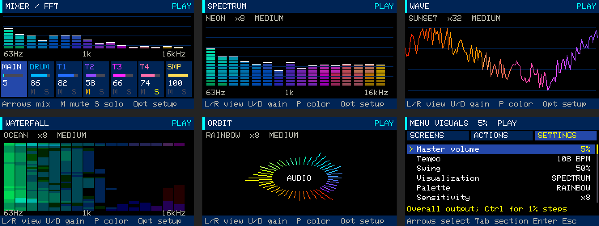
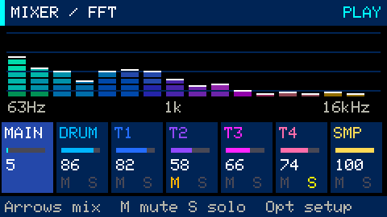

# Audio visuals, FFT mixer and RGB feedback

**Fn+7** opens **Mixer FFT**. **Fn+8** opens **Visuals**. Both are also available
under **Opt → SCREENS** and in the eight-workspace Tab cycle.
[All guides](README.md) · [Keyboard controls](controls.md)



These views analyze the actual mixed output, including drums, synths and samples.
They respond to live playing as well as recorded scenes and songs. Master mute or
zero output produces silence in the analyzer; a synth's release remains visible
and audible after transport stops until the note fades out.

## Mixer FFT



The upper half shows a colored spectrum of the **master output**. The lower half
controls the same MAIN, DRUM, T1..T4 and SMP levels as the original Mixer.

- **Left/right** selects a strip; **up/down** changes its level by 5%, or 1% with Shift.
- **M / S** toggles track mute/solo. MAIN has neither.
- **Fn+Z** undoes the last mixer edit.
- Plain **+ / −** always changes MAIN; Ctrl gives 1% steps.
- **Opt → SETTINGS** contains channel controls, palette, sensitivity, smoothing
  and RGB brightness.

The spectrum is for the combined output, not a separate FFT for each strip. Fader
bars display configured levels rather than measured channel peaks.

## Four visualizations

| Mode | Display |
|---|---|
| **Spectrum** | Sixteen colored frequency bands with segmented bars |
| **Wave** | A colored waveform with a rising-crossing trigger to reduce jitter |
| **Waterfall** | Recent spectrum history, with low frequencies on the left and newest data at the top |
| **Orbit** | Forty-eight radial strokes whose lengths follow the spectrum |

In Visuals, **left/right** or **Enter** changes mode, **up/down** changes sensitivity,
and **P** cycles the color palette. Fn is not needed. Space controls transport;
Esc opens the menu. Switching between these views does not interrupt the song.


## Configure the appearance

Open **Opt → SETTINGS**:

| Setting | Values / behavior |
|---|---|
| Visualization | Spectrum, Wave, Waterfall, Orbit |
| Palette | Neon, Sunset, Ocean, Rainbow; shared by visuals and RGB |
| Sensitivity | Display gain ×1, ×2, ×4, ×8, ×16 or ×32; does not change audio volume |
| Smoothing | Fast, Medium or Slow spectrum release |
| Motion speed | 1–3; waterfall scrolling and orbit rotation |
| RGB brightness | 0–50% in 5% steps; zero disables the LED |

At low listening levels, raise **Sensitivity** to make the waveform easier to see.
Tests and demos use 5% audio volume; visual gain remains independent.

These are device-wide display preferences, separate from song files. They save to
the `gb-visual` NVS namespace after three idle seconds while playback/recording and
live synth/sample voices are stopped. Project switching and reboot retain them.
Isolated hardware tests use defaults and never write normal display preferences.

## RGB LED

RGB feedback works in every workspace, including instrument playing. Color follows
the approximate pitch class of the strongest FFT bin, while brightness follows
output energy. Chords and percussion can change color as their dominant frequencies
change; this is audio feedback, not exact MIDI-note identification. The selected
palette and RGB brightness control it. At silence, the LED turns off.

On Cardputer ADV, GPIO38 powers the RGB LED and controls the display backlight.
While RGB is enabled, Groovebox uses full backlight for stable LED power. Setting
**RGB brightness → 0%** sends black and restores the previous fixed display level
(120/255). This follows the board's [RGB power and LCD pin map](https://docs.m5stack.com/en/core/Cardputer-Adv#rgb-led-power-supply).
Data is sent on GPIO21 using the ESP32-S3 RMT peripheral; see the
[Stamp-S3A schematic](https://m5stack-doc.oss-cn-shenzhen.aliyuncs.com/1150/Sch_StampS3_v0.3.3.pdf)
and [ESP-IDF RMT documentation](https://docs.espressif.com/projects/esp-idf/en/v5.5.1/esp32s3/api-reference/peripherals/rmt.html).

## Analysis and validation

A nonblocking audio tap copies requested 512-frame mono snapshots of the final
32 kHz PCM output. FFT processing runs on the UI core, at up to 20 updates per
second, using a Hann window and DC removal. Bin spacing is 62.5 Hz; sixteen bands
span roughly 63 Hz–16 kHz. Bars use a 72 dB display range with adjustable gain.
The analyzer uses fixed buffers. A busy UI may miss an animation frame without
blocking audio. This compact display is intended for musical feedback rather than
precision audio measurement.

```bash
make test
python3 -m unittest discover -s tools -p 'test_*.py'
python3 tools/device_audio_visual_test.py
python3 tools/device_sampler_test.py --stress
make render-interface
```

The hardware tests enforce 5% output, use isolated projects and verify that the
normal project and backup remain unchanged. USB command `B` reports analysis frames,
peak, dominant bin, FFT time, visual settings and RGB transmission status. It cannot
optically verify the LED's emitted color. `make render-interface` regenerates the
documentation images using the application drawing code and demo-engine PCM at 5%.

### Device measurements for this update

The automated audio-visual scenario passed at 5% output: the measured FFT maximum
was 0.84 ms and display-frame maximum about 15.6 ms. Neon Drive chorus playback
peaked at 24.3% of the audio core with no new I2S/event overflows or exchange errors.
RGB transmissions completed without driver errors and their color values changed
with live notes and song audio; emitted light was not measured optically.

A separate 60-second sampler stress run combined four sample voices, four synth
voices, eight drums and microphone recording. Peak audio load was 42.2%, with no
new I2S/event overflows, exchange errors or dropped recording blocks. Free heap
was approximately 50 KB. The regular project and backup checksums were unchanged.
These are measurements of the tested scenarios, not a guarantee for every song.
