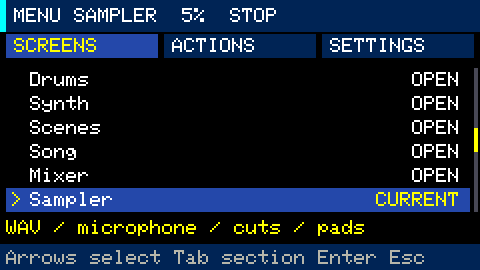
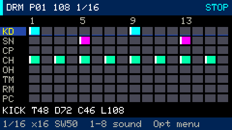
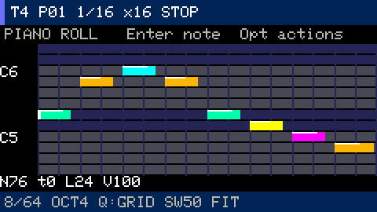
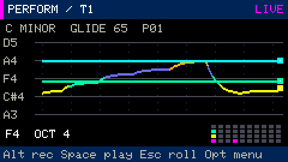
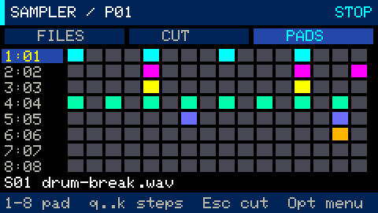

# Keyboard controls and layouts

The physical arrow keys are `,` (←), `/` (→), `;` (↑) and `.` (↓). Press them
**without Fn** in menus, Projects, help, Drums, Piano roll, Sound editor, Scenes,
Song, Mixer, Sampler and Visuals. In **Synth Performance**, these physical keys
retain their musical roles; use Fn for navigation or Esc to enter Piano roll.
Fn remains a modifier and never opens a popup. [All guides](README.md)

## Global controls

| Keys | Action |
|---|---|
| Opt | Open/close the menu; close help or Projects |
| Esc | Back/cancel; open the menu from a main workspace; Performance/Sound → Piano roll |
| Tab | Next workspace; next tab inside the menu |
| Fn+1..6 | Drums / Synth / Scenes / Song / Mixer / Sampler |
| Fn+7 / Fn+8 | Mixer FFT / Visuals |
| Space | Start/stop transport, including inside the menu |
| + / − | MAIN ±5%; hold Ctrl for ±1% |
| Alt | In Drums/Synth, arm or finish synth recording; in Sampler, start/stop microphone recording |
| Fn+Backspace | Clear the current drum, synth-note or sampler-step pattern |
| Fn+Z | Undo in the current editor |
| Fn+C / Fn+V | Copy / paste the current pattern or scene |

Projects and Quick start capture input; close them with `Opt` or `Esc` before using
workspace shortcuts. Modal key presses do not reach musical steps, while releases
of already sounding notes still work. Esc does not stop transport; use Space.

## Menu



`↑/↓` selects a row; `Tab` or `←/→` switches tabs. `Enter` runs an action.
In SETTINGS, `Enter` selects a value, arrows change it, and `Enter` finishes.
`Backspace` or `Esc` first exits editing, then closes the menu. Values apply
immediately; leaving the editor does not revert them. [Full menu guide](menu.md)

## Drums and sampler steps



```text
Step:  01 02 03 04 05 06 07 08
        Q  W  E  R  T  Y  U  I
Step:  09 10 11 12 13 14 15 16
        A  S  D  F  G  H  J  K
```

`1..8` selects a drum sound or sampler pad. `Shift+step` adds an accent.
`Fn+L` changes length; `Fn+G` changes grid. `[` / `]` selects a drum pattern;
in Sampler, use `Fn+[` / `Fn+]`. `Fn+−/+` changes tempo in Drums and the assigned
slot in Sampler. Plain `+` / `−` controls MAIN.

In Drums, these keys adjust the selected sound: `Z/X` tune, `C/V` decay,
`B/N` tone, `M/Shift+M` level (decrease/increase by 8). Selecting a sound or editing its
timbre auditions it. `Fn+W` changes global swing. Bare ↑/↓ selects a drum sound;
←/→ selects its pattern. Direct drum sound edits have no Undo and invalidate the
previous undo action.

## Synth: piano layout and note editing

The complete musical layout below is available in Performance. In Piano roll,
the four arrow keys navigate instead; use Performance when playing the full layout.

```text
White: Z X C V B N M ,       Q W E R T Y U I
Black:  S D   G H J           2 3   5 6 7
```

`Fn+−/+` changes octave; `[` / `]` changes pattern; `Fn+[` / `Fn+]` changes track.
`Shift` increases velocity. `Alt` arms/finishes recording. `Fn+Q` toggles recording
quantize. In the piano roll, arrows move the cursor or selected note;
`Shift+←/→` changes length and `Shift+↑/↓` changes velocity. `Enter` adds/selects
a note; `Fn+Enter` or `Esc` deselects; `Backspace` deletes the selected note.
`Fn+F` switches fit mode. [Recording and editing guide](stage-3.md)



## Synth: string layout

```text
1 2 3 4 5 6 7 8 9 0  — highest string
Q W E R T Y U I O P
A S D F G H J K L ;
Z X C V B N M , . /  — lowest string
```

Synth opens in **Performance** by default without changing saved sound or layout.
Choose **ACTIONS → Performance** to initialize the string layout, or choose Strings
in SETTINGS → Keyboard layout. Colored pitch trails fill the screen,
with a small pressed-key map at the lower right. The last pressed key in a row
sounds; releasing it returns to the previously held key. Choose
**SETTINGS → Keyboard layout → PIANO** to restore the piano layout. Root and Scale
are also in SETTINGS. [Performance and sound guide](synth-performance.md)



## Synth: sound and arpeggiator

`Fn+S` switches Sound editor / Piano roll. In Sound editor, `←/→` selects a
parameter and `↑/↓` changes its value. `Fn+A` changes arpeggiator mode,
`Shift+Fn+A` changes rate, `Fn+O` changes octaves, and `Fn+T` changes gate.
All parameters are also listed in SETTINGS.

## Scenes, Song and Mixer

| Screen | Controls |
|---|---|
| Scenes | Arrows select scene/track; Fn+−/+ assigns a pattern; Fn+Backspace clears a cell; Enter launches a scene |
| Song | ↑/↓ selects a row; ←/→ selects scene/repeats; Fn+−/+ edits; Fn+Enter inserts a scene; Fn+Backspace deletes a row; Enter plays |
| Mixer | ←/→ selects a strip; ↑/↓ or Fn+−/+ changes level; Shift gives fine adjustment; M toggles mute; S toggles solo |

See the [arrangement and mixer guide](stage-4.md) for the pattern-to-song workflow.

## Sampler: files and waveform

`Fn+B` opens files; `Fn+P` switches CUT/PADS; `Alt` starts/stops the microphone.
In the file list, `↑/↓` selects a WAV and `Enter` loads it. With a source loaded,
`Esc` returns from Files/Pads to Cut; otherwise it opens the menu.

In the waveform, `←/→` moves the cursor; hold `Shift` for one audio frame per
step. `↑/↓` changes zoom. `A/D` marks start/end, `R` selects the full source,
and `Enter` saves a slice. `Fn+A` selects the chop count; `Fn+Enter` chops.
`Fn+D` immediately deletes the assigned sample slot, retaining the source WAV.
Use **ACTIONS → Delete sample slot** if you want a confirmation first.



Every workspace menu includes **Key reference** for the current screen.
[Complete sampler guide](stage-5-sampler.md)

## FFT mixer and audio visualizations

`Fn+7` opens the FFT mixer: ←/→ selects a strip, ↑/↓ changes level, M/S toggles
mute/solo. `Fn+8` opens Visuals: ←/→ or Enter changes mode, ↑/↓ changes sensitivity,
and P cycles palettes. **Opt → SETTINGS** configures smoothing, motion and RGB
brightness. These arrow controls also accept Fn.
[Four visualization modes and RGB feedback](audio-visuals.md)
