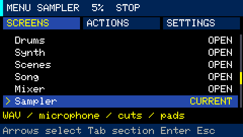

# Menu navigation and settings

Press **Opt** to open or close the menu. `Fn` is only a modifier and does not open a
popup. Open help through **SCREENS → Key reference** and the tutorial through
**SCREENS → Quick start**. [All guides](README.md)



**Esc** goes back or cancels: it first leaves value editing, then closes the menu.
On a main workspace it opens the menu; in Performance and Sound editor it returns
to the piano roll.

## Three tabs

- **SCREENS**: Drums, Synth, Scenes, Song, Mixer, Sampler, Projects, Quick start and
  Key reference.
- **ACTIONS**: commands for the current workspace, such as play, record, copy,
  paste, undo and clear. The sampler also offers WAV browsing, selection bounds,
  slice saving and chopping.
- **SETTINGS**: master volume, tempo, swing and parameters for the current workspace.

Use `Fn+↑/↓` to select a row. `Tab`, `Fn+←/→` or `[` / `]` changes tabs.
In SCREENS, `Enter` opens the selected screen; `1..6` opens a workspace directly.
`Fn+1..6` works from any menu tab.

In SETTINGS, press `Enter` to highlight a value in yellow. Use the arrows to change
it, then `Enter` to finish editing. `Backspace` or `Esc` first leaves value editing,
then closes the menu. **Values apply immediately; leaving the editor does not undo
a change.** `Tab` can switch tabs while editing.

Master volume `+` / `−` also works inside the normal menu: 5% per press, or 1% with
`Ctrl`. `Shift` changes tempo in 10 BPM steps; `Ctrl` adjusts sound parameters by 1
instead of 8. Disabled items show their reason in the footer. Copy, paste, undo and
clear display a result message.

## Available settings

All workspaces expose master volume, tempo and swing, plus:

| Workspace | Additional settings |
|---|---|
| Drums | Pattern length, grid and pattern number |
| Synth | Track, pattern, octave, length/grid, quantize, pitch zoom, preset, layout, root/scale, waveform, ADSR, cutoff/resonance, glide, level and arpeggiator |
| Scenes | Scene, track and assigned pattern |
| Song | Row, scene to insert, entry scene and repeats |
| Mixer | Channel, channel level, mute and solo |
| Sampler | Pad, assigned slot, pattern, chop count, length and grid; slot selection shows the source WAV filename |

## Actions and recording

Opening the menu does not stop playback or recording. Notes held before opening
it can still be released; navigation keys do not play new notes. `Space` controls
transport from the menu. Changing workspace ends synth recording, just like
`Fn+1..6`; microphone recording continues independently.

Sampler ACTIONS includes Browse WAV, Record microphone, Waveform editor, Pad
sequencer, Play/stop, Mark start/end, Save selected slice, Chop selection, Reset
selection, Clear steps, Undo and Delete sample slot. Saving and deleting slices
requires stopped transport. **Delete sample slot** opens a confirmation: `Enter`
deletes, `Backspace` or `Esc` cancels. The source WAV remains on the card.

Pattern length/grid, synth sound and arpeggiator edits use the existing undo
mechanism. Project settings save after stopping or after three idle seconds while
stopped. Menu position and the selected menu row are not stored in the project.

Projects and help are separate modal screens that capture keyboard input; close
them before using workspace shortcuts or volume keys.

See [projects](projects.md), [quick start](quick-start.md), [controls](controls.md)
and [synth Performance](synth-performance.md).

## Developer checks

```bash
make test
python3 -m unittest discover -s tools -p 'test_*.py'
tools/idf.sh firmware build
python3 tools/slot.py install-app firmware/build/groovebox.bin
python3 tools/device_menu_test.py
```

Hardware checks use an isolated project and a 5% audio output ceiling. See the
[installation requirements](../README.md#build-and-install) before installing firmware.
