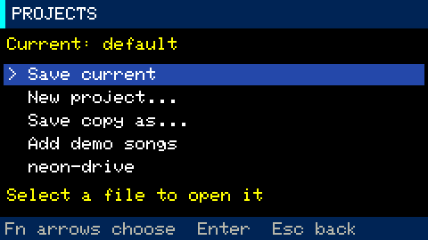

# Projects: create, save, load and recover

Stop playback and recording, then open **Opt → SCREENS → Projects**.
[All guides](README.md)

## Project actions

- **Save current** saves immediately.
- **New project…** creates an empty project after you enter a name and press
  `Enter`. Your current project saves before switching. The new project inherits
  the current volume to avoid an unexpected jump.
- **Save copy as…** writes a separate version while you continue in the current
  project. Open the copy from the list if you want to edit it instead.
- **Add demo songs** installs seven [complete demo arrangements](../examples/README.md)
  without changing the current project or overwriting existing demo filenames.
- **A project name in the list** opens that project. Press `Enter` to show the
  confirmation, then `Enter` again to save your current work and switch.
  `Backspace` or `Esc` cancels.

Enter a name using 1–23 characters: `a-z`, `0-9`, `-` or `_`. `Backspace` deletes a
character; `Opt` or `Esc` cancels name entry. New and Save copy do not overwrite an
existing name. The browser lists up to 32 projects and reports when that limit is
exceeded; move extra `.gbp` files to your computer for a larger collection.

## Storage and switching

Projects live in `/groovebox/projects/`. The selected name is recorded in
`active.txt`; `active.bak` can restore the previous selection if power fails during
a switch. Switching projects restarts the device to clear voices and editor queues
and load the appropriate sample cache. Startup reopens the last selected project;
without a selection it uses `default.gbp`.

Autosave runs after transport stops, or after three idle seconds while stopped.
Saving uses a temporary file and keeps the previous version as `.gbp.bak`. A failed
write is not reported as a successful save.

## Recover a damaged project

If the primary file is damaged, the loader tries its backup. **BACKUP** indicates
recovery mode: autosave over the original is blocked. Use **Save copy as…** with a
new name first. In recovery mode, a successful Save copy selects the saved copy and
restarts into it. The damaged original and its backup remain on the card.

## Transfer projects between cards or computers

A project contains patterns, scenes, song entries, mixer and synth settings,
root/scale/layout, and WAV references with slice boundaries. **Audio is not embedded
in `.gbp` files.** Copy both `/groovebox/projects/` and `/groovebox/samples/` when
transferring your work. A project copy shares the original WAV files.

The firmware reads GBP v1–v5 and writes v5. Older firmware without v5 support cannot
open new saves. [Sampler storage and cache details](stage-5-sampler.md#storage-and-project-format)
