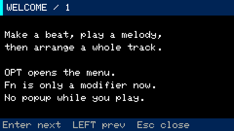
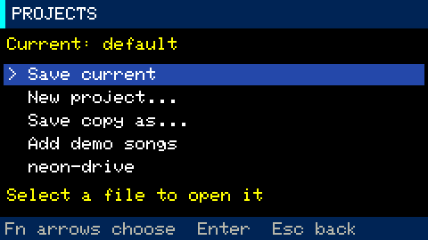
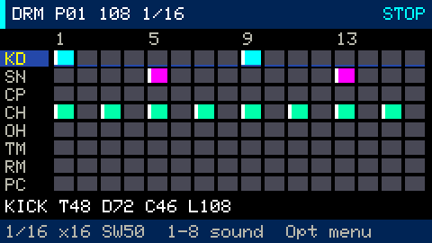
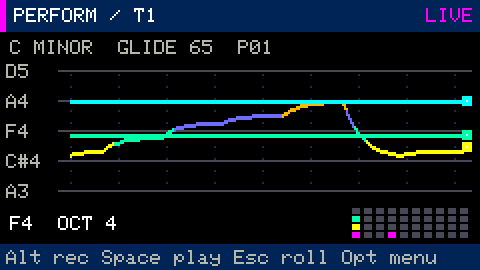
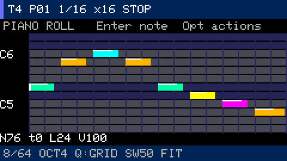
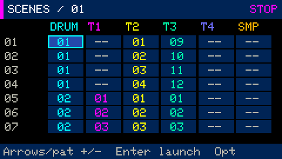
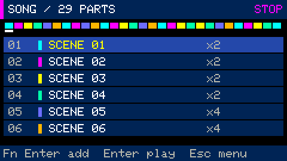
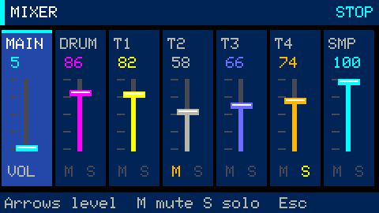
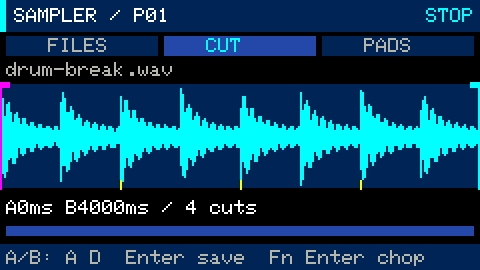

# Quick start: make your first track

The same walkthrough is available on the device at **Opt → SCREENS → Quick start**.
Press `Enter` or `Tab` for the next page, `←` for the previous page, and `Esc` or
`Opt` to close it. [Keyboard reference](controls.md) · [All guides](README.md)

## 1. Create a project

Insert a microSD card and open **Opt → SCREENS → Projects**. Select **New project**,
type a name and press `Enter`. The device saves your previous work and restarts
with an empty project. Use `−` to lower the volume; `+` raises it in 5% steps.
Close Projects before using the volume keys.

## 2. Make a beat

Press `Fn+1` for **Drums**. Choose the kick with `1` and press `Q`, `T`, `A`, `G`
(steps 1, 5, 9, 13). Choose the snare with `2` and enable `T` and `G`.
Press `Space` to loop the beat. Press an enabled step again to turn it off;
use `Shift` with a step key for an accent.

## 3. Add a melody

Press `Fn+2` for the default Performance view. To initialize the string layout,
choose **Opt → ACTIONS → Performance**. The keyboard rows now play as
four strings. Hold `Z` and press `X`: the pitch slides upward. Release `X` to return
to `Z`. Play across rows for a chord.

In **SETTINGS**, choose **Sound preset**, **Keyboard layout**, **Root note** and
**Scale**. Strings follows the selected scale; choose Piano for a chromatic layout.

With the loop playing, press `Alt`, play your part, then press `Alt` again to finish
recording. Open **ACTIONS → Piano roll**: notes appear immediately and the visible
pitch range follows your part. `arrows` moves the cursor, `Enter` adds or selects
a note, and `Backspace` deletes a selected note. **Undo** reverses the last recording
pass as a single action.

## 4. Make a variation

Stop with `Space`. Choose **ACTIONS → Copy pattern**, select another **Pattern** in
**SETTINGS**, then choose **ACTIONS → Paste pattern**. Change a few notes. Do the
same for the drums. Copying leaves the original pattern intact.

## 5. Arrange scenes and a song

Press `Fn+3` for **Scenes**. Select a scene and assign patterns to DRUM, T1..T4 and
SMP in **SETTINGS**. An empty cell leaves that track out. `Enter` launches the scene.

Press `Fn+4` for **Song**. Select **Insert scene** in **SETTINGS**, then execute
**Insert scene** in **ACTIONS**. Repeat for the next sections. **Repeats** sets the
length of each section. `Enter` plays from the selected row; `Space` stops.

## 6. Mix and save

Press `Fn+5` for **Mixer**. Choose **Channel** and **Channel level** in **SETTINGS**;
use **Mute/Solo** in **ACTIONS**. `+` / `−` controls MAIN in workspaces and the normal
menu. Stop playback, then open **Opt → SCREENS → Projects → Save current**.

## 7. Add samples

Copy WAV files to `/groovebox/samples/` on the card. Press `Fn+6`, then
**ACTIONS → Browse WAV files**. Alternatively, choose **Record microphone**; the
same action becomes **Stop microphone** during recording.

In **Waveform editor**, move the cursor and mark the start with `A` and the end
with `D`. Stop transport, then press `Enter` to save the slice. **Pad sequencer**
places it on steps. See the [sampler guide](stage-5-sampler.md) for chopping and assignments.

To explore a finished arrangement, install an [original demo song](../examples/README.md)
from **Projects → Add demo songs**, load it, then press `Fn+4` and `Enter`.

## 8. Add visuals and RGB feedback

Press `Fn+7` for the Equalizer FFT, or `Fn+8` for four audio-reactive visualizations.
Use bare left/right to change visual mode and up/down for sensitivity. P changes
colors. Opt → SETTINGS includes smoothing, motion and RGB brightness; 0% turns the
LED off. [Visuals and RGB guide](audio-visuals.md)
