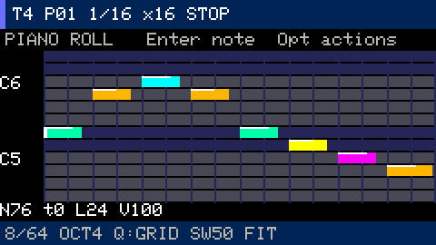
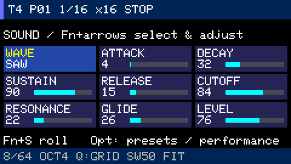

# Synth tracks: live recording and piano roll editing

Groovebox provides four synth tracks alongside the drum machine. Each track has
16 patterns, with up to 64 notes per pattern. Five voices are shared by all synth
tracks and live playing; this drops to four while samples play. When voices run
out, the quietest is stolen, with the oldest breaking a tie.



[Performance, strings and presets](synth-performance.md) ·
[Keyboard controls](controls.md) · [All guides](README.md)

## Record your first part

1. Make a drum pattern, then press `Tab` or `Fn+2`.
2. Play `z x c v b n m ,` and `q w e r t y u i`. Black keys are `s d g h j` and
   `2 3 5 6 7`. `Fn+−/+` changes octave; `Shift` increases velocity.
3. Press `Alt` to arm recording, then `Space` to start the loop. If already playing,
   `Alt` starts recording immediately.
4. Play a part and release the keys. Press `Alt` again to finish recording while
   the loop continues; `Space` finishes recording and stops playback.
5. After stopping, the project saves to SD. Edits made while stopped save after
   three idle seconds. `Fn+Z` undoes the last edit or the entire last recording pass.

Patterns play together in the selected scene. `Fn+[` / `Fn+]` changes synth track;
`[` / `]` changes that track's pattern. `Fn+1` returns to Drums. Changing workspace,
track or pattern finishes recording and releases live keys. Simply browsing a
workspace or selecting a track does not fill empty scene cells; adding notes,
recording or explicitly selecting a pattern assigns it.

## Edit notes

| Keys | Action |
|---|---|
| Fn+arrows | Move the cursor, or change the selected note's start/pitch |
| Enter | Select the note under the cursor or add one; repeated presses cycle overlapping notes |
| Fn+Enter / Esc | Deselect the note |
| Backspace | Delete the selected note |
| Shift+Fn+←/→ | Change length |
| Shift+Fn+↑/↓ | Change velocity |
| Fn+C / Fn+V | Copy / paste the pattern |
| Fn+Z | Undo the last action |
| Fn+Backspace | Clear all notes in the current pattern |
| Fn+L | Cycle pattern length: 16 / 4 / 8 steps |
| Fn+G | Cycle grid |
| Fn+W | Cycle global swing |
| Fn+Q | Toggle recording quantize |
| Fn+F | Switch fit / semitone pitch zoom |

The physical arrows are `Fn+,` left, `Fn+/` right, `Fn+;` up and `Fn+.` down.
Changing grid does not move existing notes. Notes beyond a shortened pattern's end
remain in the project; **HIDDEN** indicates their presence.

Held keys appear immediately in orange, and the pitch window follows the played
note. Opening a pattern shows its note range; FIT includes the whole range.
Recording supports chords and notes crossing the loop boundary. Holding a note
longer than one loop saves a single loop-length note. With quantize off, timing is
stored at 96 PPQN; keyboard events apply at 256-frame audio-block boundaries.
**NOTE FULL** means new notes can no longer be recorded, but live playing still
works. Editing the target synth pattern is temporarily disabled during recording.

## Shape the sound



`Fn+S` switches between sound parameters and the piano roll. `Fn+←/→` selects a
field; `Fn+↑/↓` changes it. Available controls are sine/triangle/saw/square, ADSR,
low-pass cutoff, resonance, glide and level. Parameter edits do not reset the phase
of sounding notes.

Attack and decay reach two seconds, release four seconds, and glide one second.
Synth parameters and quantize settings save with the notes. The current firmware
reads GBP v1–v5 and saves v5. See [projects](projects.md) for backup and recovery.

## Developer checks

```bash
make test
python3 -m unittest discover -s tools -p 'test_*.py'
make render-synth
tools/idf.sh firmware build
python3 tools/slot.py install-app firmware/build/groovebox.bin
python3 tools/device_test.py
python3 tools/device_synth_test.py
```

`build/synth.wav` contains examples of all four waveforms, a chord, filter and glide.
Hardware checks use a separate `stage3-test.gbp`, retain test mode across reboots,
then restore the regular project and compare checksums of `default.gbp` and its
backup. Audio checks use a 5% output ceiling. If a test is forcibly interrupted,
stop transport and send `T end` over USB to leave test mode.

USB console: `K <modifiers> <key>` sends a complete press; `D` and `U` send separate
press/release events. Modifiers `f`, `s`, `c` mean Fn, Shift, Ctrl; `-` means none.
Special key names include `space`, `tab`, `alt`, `enter`, `back`, `fn`, `shift`, `ctrl`.
`S` prints transport/drums; `I` prints synth/notes; `C` prints load, voices and
counters; `C reset` starts a new peak-measurement window; `H` prints regular-project
checksums. Follow the [installation requirements](../README.md#build-and-install).
