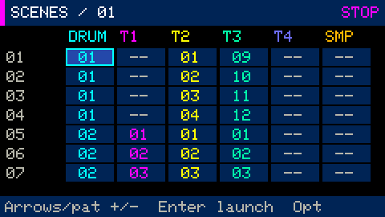
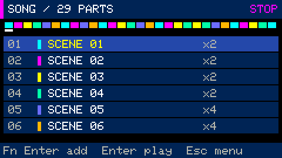
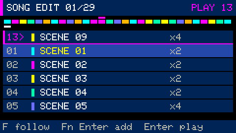
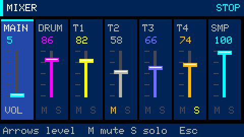

# Scenes, song arrangement, mixer and arpeggiator

Build reusable patterns, combine them into scenes, then arrange scenes into a song.
`Fn+1..6` opens Drums, Synth, Scenes, Song, Mixer or Sampler. `Fn+7` opens Equalizer FFT and
`Fn+8` opens Visuals; `Tab` cycles all eight.
`Space` starts/stops playback. In Song, playback starts from the selected entry.
[Menu guide](menu.md) · [All guides](README.md)

## Menu and master volume

`Opt` opens the menu; `Fn` only modifies keys. Help is under **SCREENS → Key reference**,
the tutorial under **SCREENS → Quick start**, and workspace settings under SETTINGS.

`−` and `+` (or `=`) adjust MAIN by 5%. `Ctrl+−/+` uses 1% steps. The `Shift` needed
to type `+` does not change that step. Volume is limited to 0–100%, stored in the
project and briefly shown as a bar over the workspace. Close Projects/help first,
as those modal screens capture input.

With `Fn`, these keys adjust tempo in Drums, octave in Synth, pattern assignment in
Scenes, scene/repeats in Song, and the selected strip in Mixer.

## Clear patterns and keep notes visible

`Fn+Backspace` clears the current drum steps or synth notes without changing length,
grid or sound. `Fn+Z` undoes the clear. During recording, held notes are finalized
before the pattern clears, so Undo restores those newly recorded notes too.

Held synth keys appear immediately in orange. The pitch window follows live keys
and focuses the accepted note after recording. Opening an existing pattern shows
its register. FIT displays the full note range; `Fn+F` switches between FIT and
semitone zoom. See [piano roll editing](stage-3.md).

## Arrange a track

Create your blocks first: `[` / `]` selects one of 16 drum patterns. In Synth,
`Fn+[` / `Fn+]` selects T1..T4 and `[` / `]` selects its pattern.



1. Open `Fn+3`. Each row is a scene; columns are DRUM, T1..T4 and SMP.
2. `↑/↓` or `[` / `]` selects a scene; `←/→` selects a track. `1..6` also
   selects the track column.
3. `Fn+−/+` chooses a pattern; `--` means no pattern on that track. `Fn+Backspace`
   clears the cell.
4. `Fn+C` / `Fn+V` copies/pastes a scene; `Fn+Z` undoes the last edit.
5. `Enter` launches the selected scene. During playback it waits for the next bar
   boundary: `+` marks the queued scene and `>` marks the playing scene.
6. Select a scene and open `Fn+4`. `Fn+Enter` inserts it before the selected song
   entry. Move down to **+ ADD** to append at the end.
7. `↑/↓` selects an entry; `←/→` selects SCENE/REPEAT; `Fn+−/+` changes the
   value. `Fn+Backspace` deletes the entry; `Fn+Z` undoes the edit.
8. `Enter` or `Space` plays from the selected entry. Playback stops after the last
   entry; the next `Space` starts again from the selection.



### Follow the playing scene

Scenes and Song both show a **magenta play marker above the minimap** and a `>`
beside the playing row. The **white underline** marks the edit selection; an amber
mark in Scenes indicates a queued launch. A queued scene becomes the play marker
only when it actually starts. Song marks the exact song row, even when several
rows use the same scene.

Playback starts with **FOLLOW** enabled. The list automatically changes pages to
keep the playing scene/song row visible. Arrows or edits switch to browsing without
moving the playback position. If the playing row is outside the browsing page,
it is **pinned at the top**, with a magenta separator.



Press **F** without Fn, or choose **Opt → ACTIONS → Follow playback**, to resume
automatic scrolling. The `EDIT` number in the header remains your selected scene
or song row: following does not change an edit target, project data, or the row
used by Enter/Space to start playback. After stopping, the list returns to the
edit selection and the play marker disappears. A scene loop shows no false Song
play marker.

A project holds 16 scenes and up to 64 song entries, each with 1–255 repeats.
An empty scene lasts one bar. Patterns are shared: editing P01 changes it in every
scene that uses it. Opening Drums/Synth after selecting a scene edits that scene's
assignment, rather than always scene 01.

When recording over a song, `Alt` targets the pattern in the scene actually playing.
Moving to the next song scene ends recording into that pattern; changing workspace
also ends it. Synth auditioning works with transport stopped.

## Synth arpeggiator

- `Fn+A`: Off → Up → Down → UpDown.
- `Shift+Fn+A`: rate/grid, including triplets.
- `Fn+O`: one, two or three octaves.
- `Fn+T`: gate of 25%, 50%, 75% or 100% of a step.

Choose a mode and hold a chord. The arpeggiator handles both live keys and recorded
chords. Recording stores the source chord and arpeggiator settings, so playback
recreates the sequence without filling the pattern with hundreds of short notes.
Changing settings ends current holds; play the chord again. All four synth tracks
and live playing share five voices, or four while samples sound.

## Mixer



`Fn+5` opens MAIN, DRUM, T1..T4 and SMP. `←/→` selects a strip; `↑/↓` or
`Fn+−/+` changes level by five percentage points, or one with `Shift`. `M` toggles
track mute and `S` toggles solo; mute takes priority. MAIN has no mute/solo.
`Fn+Z` undoes the last edit. MAIN controls the full output after the limiter.
The faders show **configured levels**, not VU measurements.
To shape frequency bands while watching the output spectrum, open [Equalizer FFT](audio-visuals.md)
with `Fn+7`.

Scenes, song entries, levels, mute/solo and arpeggiator settings save to SD.
The current firmware reads GBP v1–v6 and writes v6. Tests use a separate file and
do not replace a regular project's volume with the test level.

## Automated checks

Test mode resets master volume to 5% on each boot, regardless of the loaded file.
An independent ceiling prevents output above 5% even if a test raises the fader.
`LEVEL` checks measure the digital I2S signal; a peak above 1557 fails. Microphone
levels are also measured, but room noise at this volume is not used as a mandatory
audibility threshold. The regular project and backup are checked and restored.

```bash
make test
python3 -m unittest discover -s tools -p 'test_*.py'
tools/idf.sh firmware build
python3 tools/slot.py install-app firmware/build/groovebox.bin
python3 tools/device_arrangement_test.py --stress
python3 tools/device_follow_test.py
python3 tools/device_synth_test.py
python3 tools/device_test.py
```

USB command `A` prints scenes, song entries and mixer; `I` includes arpeggiator
settings; `S` includes active/queued scene and song state. `A` also reports each
list's first row, live row, pin/follow state and edit selection. After an interrupted test,
stop transport and send `T end`. Follow the
[installation requirements](../README.md#build-and-install).
