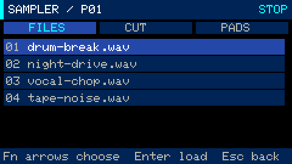
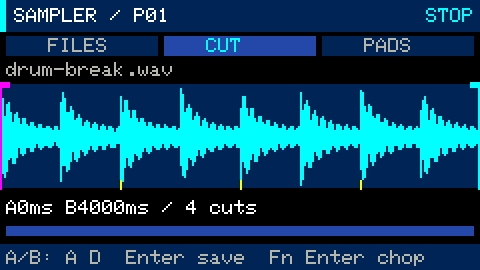
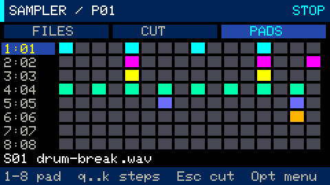

# Sampler: WAV import, microphone recording, slicing and sequencing

Press `Fn+6` for **Sampler**, an independent SMP track alongside the drums and four
synths. Use `Opt` for its menu; Fn remains a modifier. Master volume `+` / `−` and
`Ctrl` fine adjustment work here too. [Menu](menu.md) · [All guides](README.md)

## Load audio from microSD



Put WAV files in `/groovebox/samples/` on the SD card; the folder is created
automatically. Supported formats are PCM 8/16/24/32-bit and float32, mono/stereo,
8–192 kHz. Filenames may contain up to 47 bytes including the extension; nested
folders are not used. Convert MP3/AAC to WAV first.

Source files remain unchanged. Playback material is converted to 32 kHz, 16-bit
mono: stereo channels are averaged and resampling uses linear interpolation.

Press `Fn+B`: `Fn+↑/↓` selects a file, `[` / `]` changes page, and `Enter` opens the
waveform. `Fn+B` refreshes the directory, so newly copied files appear after reopening
it. Processing runs in a background task while the interface stays responsive.

## Record the microphone

Press `Alt` in Sampler to record. Press it again to finish, close the WAV and open
its waveform. Recording can continue while a scene/song plays and while you visit
other screens; return with `Fn+6` to stop it. Files receive the next available name,
such as `REC00001.WAV` or `REC00002.WAV`. Existing recordings are not overwritten.

The screen shows duration and changing amplitude. The microphone is not monitored
through the speaker, preventing a direct feedback loop, though the physical
microphone can still pick up speaker output. Waveform display gain adjusts
automatically without changing file volume.

Until recording finishes, the file has a `.WAV.part` extension. On write failure it
is kept for recovery and an error appears. A buffer overflow stops recording with
a message about the partially saved WAV.

## Select and chop a waveform



In **CUT**:

| Keys | Action |
|---|---|
| Fn+←/→ | Move the waveform cursor; the viewport follows |
| Shift+Fn+←/→ | Move by one audio frame |
| Fn+↑/↓ | Zoom in/out around the cursor |
| A | Set selection start at the cursor |
| D | Set selection end at the cursor |
| R | Select the full source and reset zoom |
| Enter | Save the selection to a free slot and assign it to the selected pad |
| Fn+A | Cycle equal-chop count: 4 → 8 → 16 → 32 |
| Fn+Enter | Save the selection as that many equal slices |
| 1..8 | Select a pad and audition its slice |
| Fn+−/+ | Assign the previous/next slot S01..S32 to the pad |
| Fn+D | Immediately delete the selected pad's sample slot; keep the source WAV |

Selection bounds, the cursor and proposed chop positions are marked over the
waveform. A/B positions below it are in milliseconds; the bottom overview shows the
visible portion of the whole source. Saving always uses free slots and never
overwrites existing slices. Equal chopping assigns the first eight pieces to pads
1..8 of the current pattern; assign other slots manually to use the remaining pieces.

Preparing or deleting slices requires stopped transport, because flash writes do
not run during playback. Starting playback is blocked during that operation. A read
failure or insufficient space leaves new assignments unapplied. Source WAV files
are never deleted by slice operations. The library and assignments save with the
project. For confirmed deletion, use **ACTIONS → Delete sample slot** instead of
`Fn+D`.

## Sequence pads and arrange a song



`Fn+P` switches between **CUT** and **PADS** (the pad sequencer). In PADS:

- `1..8` selects and auditions a pad.
- `qwertyui` / `asdfghjk` toggles steps 1..16; hold `Shift` for an accent.
- `Fn+[` / `Fn+]` selects P01..P16.
- `Fn+−/+` assigns a slot to the selected pad.
- `Fn+L` changes length; `Fn+G` changes grid.
- `Fn+C` / `Fn+V` copies/pastes a pattern, including pad assignments.
- `Fn+Backspace` clears steps while preserving length, grid and assignments;
  `Fn+Z` undoes the edit.
- `Space` starts/stops the scene.

Each pattern stores its own eight pad assignments, so a song can use all 32 slots.
Editing or explicitly selecting a pattern assigns it to SMP in the selected scene.
In Scenes, choose SMP with `Fn+→` or `6`, then use `Fn+−/+` to assign its pattern.
The Mixer has a separate SMP level, mute and solo. Sample scenes fit into the normal
[song arrangement](stage-4.md).

Four sample voices can sound simultaneously; excess notes steal the oldest voice.
Short fades smooth their beginnings and ends. While samples sound, the synth budget
is four voices; otherwise it is five. A reduced budget removes the quietest synth
voice with a short fade to retain audio processing headroom.

## Storage and project format

Playback reads prepared PCM from the dedicated 4 MB `samples` flash partition at
`0x3e0000..0x7e0000`. It holds about **65.4 seconds total** across saved slices,
including overlapping material. A long source can remain on SD: save the fragments
you need rather than an entire multi-minute file. Delete unused slots to free space.

The cache is checked against project/source metadata and checksums, then rebuilt
from WAV files if needed. Its header is committed after the PCM, so an interrupted
preparation is not treated as a finished library.

Sampler data was introduced in GBP v4; current saves use v5 and load v1–v5.
Older v1/v2/v3 projects start with an empty sampler track. Autosave runs after three
idle seconds while stopped; microphone recording and file operations defer it.
The audio task performs no file I/O or memory allocation. A 16 KB microphone queue
separates audio capture from SD writes; USB exposes drop counters and errors.

Keep source WAV files with your [project backups](projects.md), because `.gbp`
files store references and slice bounds rather than embedded audio.

## Developer checks

```bash
make test
python3 -m unittest discover -s tools -p 'test_*.py'
tools/idf.sh firmware build
python3 tools/slot.py install-app firmware/build/groovebox.bin
python3 tools/device_sampler_test.py
python3 tools/device_sampler_test.py --stress
```

Installation adds the sample partition after the existing application slot while
preserving Launcher, GLIDE and other partitions. Do not use ordinary `idf.py flash`
for this layout. The installer rejects overlaps; see
[build and installation requirements](../README.md#build-and-install).

Checks use an isolated project and `/groovebox/test-samples/`, master at 5% and an
independent 5% output ceiling. USB command `J` shows the library, assignments,
microphone and cache status. `W begin/data/end` uploads test WAVs only in isolated
mode; arbitrary paths are rejected.

## Stage 5 validation record

At the sampler implementation stage, 194 C++ checks with ASan/UBSan and 55 Python
checks passed. Device checks covered 16 kHz stereo WAV conversion, boundaries,
chopping, pads, the SMP mixer, persistence and deletion after reboot. Microphone
recording was checked through nonzero ADC input and playback of recorded PCM.

A one-minute 240 BPM stress test combined dense four-voice synths, all eight drums,
four sample voices and microphone recording to SD. Peak rendering load was 41.3%,
with no new I2S/event overflows or recording drops. Free heap was 68,144 bytes;
stack margins were 7,028 bytes for audio and 4,208 for UI. Hot DSP functions ran
from IRAM and the sine table from DRAM. RGB332 display buffering saved 32,400 bytes
versus RGB565. Codec initialization waited for reset completion and retried failed
register writes.

Synth regression checks also passed: live playing, recording/editing, restart,
v1 migration and dense patterns at 40/240 BPM for 15 seconds each. Without samples,
all five synth voices were available; the 240 BPM peak was 43.2%, with no new I2S
errors. These are measurements of those scenarios, not limits for every song.
All audio checks used the 5% ceiling and left the regular project, backup and source
WAVs unchanged. See the [later visual refresh results](visual-refresh.md#validation-record).
