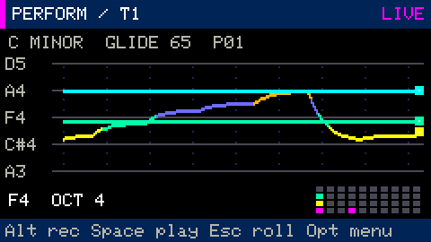
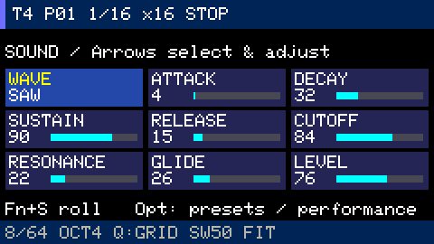
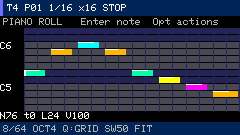

# Synth Performance: strings, legato and sound presets

Press `Fn+2` to open the synth in **Performance** by default. Startup preserves
the saved sound and keyboard layout. **Opt → ACTIONS** offers three views:

- **Performance**: smooth colored pitch trails, a small 4×10 key map, root/scale,
  glide and recording status. `Esc` returns to the piano roll.
- **Piano roll**: note editing with the recorded part's pitch range in view.
- **Sound editor**: nine parameter cards with values and bars.



Explicitly choosing ACTIONS → Performance from the piano layout enables **Strings** and
**Minor**; if glide was zero, it loads **Warm slide**. Subsequent view changes retain
the sound. Choose **SETTINGS → Keyboard layout → PIANO** to return to piano keys.
[All guides](README.md) · [Keyboard controls](controls.md)

## Strings and smooth transitions

```text
Highest  1 2 3 4 5 6 7 8 9 0
         q w e r t y u i o p
         a s d f g h j k l ;
Lowest   z x c v b n m , . /
```

Each row plays one live voice. When keys overlap, the most recently pressed key
wins; releasing it returns to the previous held key in that row. With **Glide > 0**,
legato preserves the envelope, oscillator phase and filter state. Play across rows
for chords. The scale constrains available notes; adjacent rows start a fourth
apart, adjusted upward to the scale.

**SETTINGS** includes Keyboard layout, Root note (C..B), and Scale (Chromatic,
Major, Minor, Pentatonic). These are saved separately for each of the four tracks.
Root/scale does not transpose the piano layout. `Fn+−/+` changes octave;
plain `+` / `−` changes master volume.

Glide ranges from 0 to 127 with a quadratic time scale up to one second. At zero,
a new key retriggers the note. Overlapping legato preserves the envelope; after
all keys in a row are released, the next note starts a new attack. The arpeggiator
uses the active string notes, but its individual steps have their own attacks.

Pitch trails visualize live and current-pattern note events, with smoothing that
illustrates glide. They are not an oscilloscope or an exact audio-frequency reading.

## Starting sounds

Choose **SETTINGS → Sound preset**: Warm slide, Round bass, Soft keys, Slow pad,
Acid lead or Pure sine. These are Groovebox's own presets. A preset changes the
current track's waveform, ADSR, cutoff/resonance, glide and level; Undo restores
the whole previous sound.

The selector name is the last preset chosen in the current session. Manual edits
may make the sound differ from that preset; the project stores the actual parameters.



For manual adjustment, open **Sound editor** or press `Fn+S`. `←/→` selects a
card; `↑/↓` changes its value. The same parameters appear as a list in SETTINGS,
where `Ctrl` gives a fine step. Waveforms are sine, triangle, saw and square.

## Record and edit a performance

Press `Alt` to arm recording and `Space` to start transport. If transport is already
playing, `Alt` starts recording immediately. Press `Alt` again to finish the pass.
In Strings, each transition is recorded as a separate note with its duration.



The piano roll supports quantize, start/pitch/length/velocity editing, copying and
undo. Recorded clips play through the shared polyphonic engine: finger-hold history
is not stored as separate automation, so playback does not guarantee identical live
legato articulation. See [live recording and note editing](stage-3.md).

## Relationship to GLIDE

The interaction reference is
[CHARL3X's GLIDE Synth](https://github.com/CHARL3X/GLIDE-Synth-Cardputer-ADV).
Keyboard rows acting as strings are implemented in Groovebox's own engine.
GLIDE's generative sounds, gyro morph, effects, artwork and presets are not included;
this implementation does not promise identical sound.
