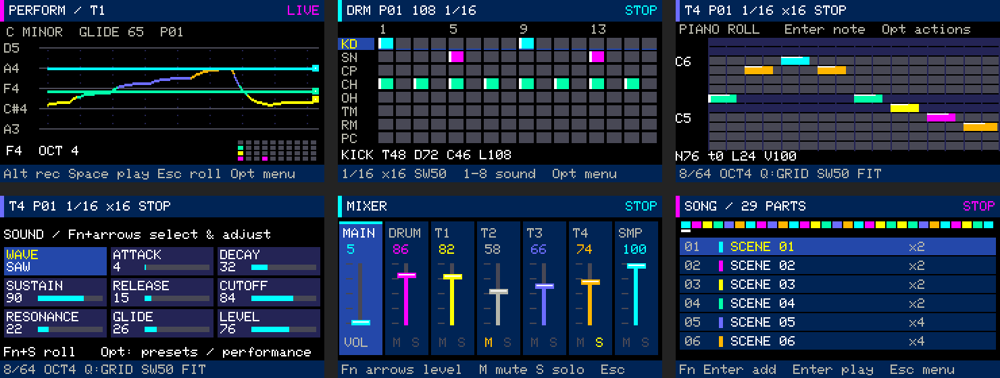
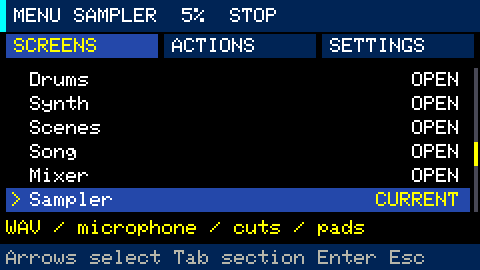
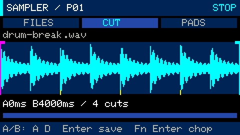

# UX/UI review and interaction decisions

This engineering review covered key handlers, all six workspaces, menus, recording,
saving and the 240×135 display, including device checks. It was not a user study.
It predates the [visual refresh](visual-refresh.md), which updates the appearance
and Performance visualization. Screenshots below show the current interface.
[All guides](README.md)

## Main problems and chosen solutions

| Priority | Observation | Solution |
|---|---|---|
| High | Fn is needed for arrows but obscures the workspace | Fn only modifies keys; Opt opens the menu; help opens explicitly |
| High | A single autosaved file makes starting a new track uncertain | Projects: New, Save, Save copy, Open list, and save before switching |
| High | Piano roll serves as both performance view and editor | Separate Performance, Piano roll and Sound editor views |
| High | Transitions retrigger attacks and a string does not return to a held key | One live token per row, legato retaining phase/envelope/filter, last-note priority |
| Medium | First steps require memorized shortcuts | Eight tutorial pages and contextual help in the application |
| Medium | Sound editing shows one parameter without an overview | A 3×3 grid of parameters, values, bars and selected field |
| Medium | Held keys are unclear during playing | A visible four-row map distinguishing held and sounding keys; later made a compact minimap |
| Medium | Clear and record are hard to discover | Contextual ACTIONS, Stop recording labels, result messages and Undo |

## Interaction structure

**Workspace → Opt → screens / actions / settings.** Frequent actions are available
in the menu, while shortcuts remain available for playing. The menu never opens
on its own. SCREENS puts Projects, Quick start and Key reference beside the six
workspaces, preserving direct `Fn+1..6` access without adding utility screens to Tab
cycling.

Synth workflow: Performance for playing → Piano roll for structure → Sound editor
for timbre. Entering Performance is explicit and supplies a starting string sound
when coming from a piano layout with no glide. Existing projects reopen with their
saved settings and do not change sound automatically.

## Workspace decisions

- **Drums:** an 8×16 grid gives an overview. Keep two groups of eight step keys and
  separate sound selection. Clear and Undo are accessible without Fn shortcuts.
- **Synth:** the instrument needs immediate feedback; the editor needs a grid and
  cursor. Separate views serve both. Root/scale affects Strings; Piano remains chromatic.
- **Scenes:** cells assign reusable patterns rather than copy audio. The guide
  explicitly teaches pattern → scene → song entry.
- **Song:** insertion and playback previously differed only by Fn. The menu names
  Insert scene and Play from row separately; repeats are in SETTINGS.
- **Mixer:** MAIN always uses plain +/− in workspaces; selected channels have separate
  adjustments. Mute/solo is unavailable for MAIN with an explanation.
- **Sampler:** files, waveform and steps are separate named modes. Slot assignment
  shows the WAV filename; menu deletion asks for confirmation.
- **Projects:** operations require stopped transport. Before opening, the UI explains
  that the current project saves and the device restarts. Save failure keeps it
  open. New/Copy does not overwrite an existing name.

## Further improvements

This review proposed a shared footer with two or three contextual actions per
workspace; the later visual refresh implements consistent short action hints.
Simplified settings remain a possible next step. Any broader control redesign
should be checked through real playing scenarios while retaining familiar shortcuts.

Possible sound improvements include oscillator detuning, effects, modulation and
spectral presets. They require CPU-budget measurements because drums, multiple
synths and samples play concurrently.

GLIDE was the reference for string behavior and visual feedback. The implementation
uses its own DSP and does not claim to reproduce GLIDE's timbres exactly.

## Validation at this stage

- 210 C++ tests with AddressSanitizer/UndefinedBehaviorSanitizer passed.
- 55 Python tool tests passed.
- Device checks covered four strings, return to held notes, release while the menu
  is open and recording a transition as three note segments.
- Quick start, New, Save copy, an empty new project, cancelled opening, restored
  steps and explicit Save were checked.
- Menu navigation, synth parameters, clear/Undo, microphone recording and saving
  across reboot were checked separately.
- Four live strings reached 10.6% peak DSP in a three-second window without new
  RX/TX overflows. This measures that scenario rather than a maximum-load song.
- Audio checks were limited to 5%; the regular project and backup were unchanged.

Hardware checks exposed a FatFs difference: rename does not replace an existing
file. Startup-project selection now rotates `active.txt` / `active.bak` with rollback
on failure rather than assuming POSIX replacement behavior.
