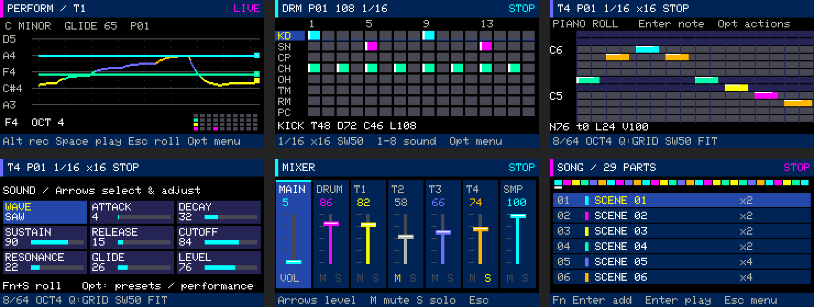
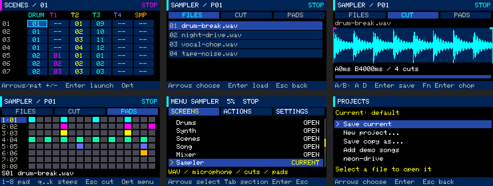
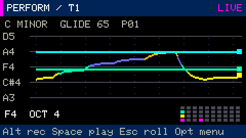

# Interface gallery and visual design review

This review covered workspaces, recording/playback states, menus, projects,
confirmations and help. The design targets the physical **240×135 display and RGB332
palette**, rather than only a desktop mockup. These screenshots use the device's UI
drawing code, rendered at 2× size. [All guides](README.md)

For the subsequent FFT mixer, four audio visualizations, bare-arrow controls and
RGB feedback, see the [audio visuals guide](audio-visuals.md).

## Shared appearance and navigation

- Dark backgrounds, navy panels, cyan active elements and consistent track colors.
- A header showing workspace and PLAY/STOP/REC state; a footer with short actions.
- Backgrounds/borders mark selection; activity, selection and mute have distinct cues.
- **Esc goes back or cancels.** On a main workspace it opens the menu. In the menu,
  it exits value editing, then closes the menu. In Performance/Sound it returns to
  Piano roll; in Piano roll it deselects a note. In Projects it cancels name entry
  or confirmation.
- Esc does not delete notes or stop global transport; `Space` stops playback.
- Browsing workspaces or choosing a synth track does not fill empty scene cells.
  Adding notes/steps, recording or explicitly choosing a pattern assigns one.
- The physical key mapping was corrected: it previously emitted a backtick, while
  Escape handling existed only in utility screens.

## Performance

The main area shows scrolling **pitch trails** over five horizontal guides.
Transitions are smoothed according to glide, and color follows pitch. The range
smoothly follows recent history so the part uses the available space. A compact
4×10 physical-key map at the lower right highlights pressed keys.

History is fixed-size: four trails, 100 points each, updated at up to 20 Hz without
allocating memory while drawing. It displays live notes and current-pattern notes
during playback. This visualizes musical events, not oscilloscope data or measured
audio frequency; the smoothing illustrates glide.

## Other screens

| Screen | Changes |
|---|---|
| Drums | Eight row labels, beat numbers, separate sound selection, percussion colors and a clear playhead |
| Piano roll | Distinct black/white pitches, pitch-colored notes, velocity top strips, separated header and status |
| Sound editor | A 3×3 card grid with consistent selection and all values visible |
| Mixer | Narrow fader tracks with handles, numeric levels, channel colors, separate M and S indicators |
| Scenes | Colored track columns, selected-cell border, separate playing and queued markers |
| Song | Sequence overview, row cards, distinct scene/repeats fields and a current-row marker |
| Sampler FILES | Visible mode tabs, readable WAV list, file number and scrolling |
| Sampler CUT | Separate filename, waveform, selection, cursor, boundaries/chops and viewport overview |
| Sampler PADS | Slot labels beside each pad, WAV filename below, the whole sequence visible |
| Menu / Projects / Help | Shared headers, panels and Esc hints; demo installation without overwriting files |

Mixer faders show **set levels**, not simulated VU readings. The bar below the
waveform shows the viewport relative to the full source. Empty sampler states
provide load and record actions.

## Example songs

[Three original retrowave/synthwave projects](../examples/README.md) are available
as files and through **Projects → Add demo songs**. They are stored separately from
the current project.

## Validation record

For this visual refresh, 214 C++ tests with ASan/UBSan and 55 Python tests passed.
Full audio renders of all three songs ended automatically without event-queue
overflows. Device checks covered physical Esc, back navigation without note
deletion, animation, demo installation/loading and all six workspaces during choruses.

In a three-second Performance window, 58 frames were drawn; the maximum frame time,
including display transfer, was 16.4 ms. Chorus DSP peaks were Neon Drive 24.6%,
Sunset Arcade 24.3% and Midnight Run 23.2%, with no new RX/TX overflows or queue
errors. These measurements apply to the checked scenarios, not every possible song.

A separate sampler check covered WAV import, microphone recording, slicing, pad
assignments, saving and cache recovery. All audio checks used a 5% output ceiling;
the original user project and backup remained unchanged. These are recorded results
from the implementation, not tests rerun by a documentation-only update.
