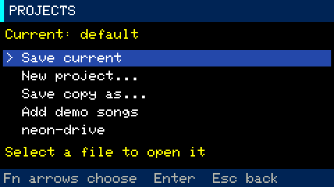
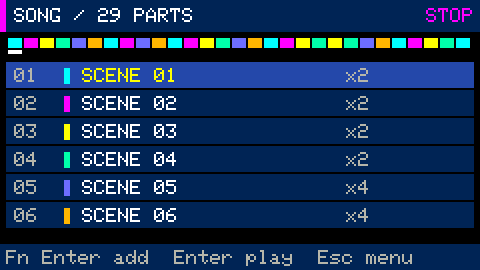

# Original synthwave, darksynth, techno and drum and bass demo projects

Eleven complete songs for Cardputer Groovebox: the first seven are GBP v5, and the
four hard techno/darksynth songs are GBP v6. All load in the current firmware. Their melodies and
arrangements were generated for this project; no external recordings or sample
files are required. [Project overview](../README.md) · [Documentation](../docs/README.md)

| Project | Character | Tempo / key | Duration |
|---|---|---|---|
| [Neon Drive](projects/neon-drive.gbp) | Driving retrowave with pulsing bass, bright arpeggios and lead | 108 BPM, A minor | ≈3:02 |
| [Sunset Arcade](projects/sunset-arcade.gbp) | Softer, slower synthwave with gentle swing | 92 BPM, D minor | ≈3:34 |
| [Midnight Run](projects/midnight-run.gbp) | Faster night-drive synthwave with a sharper bass | 122 BPM, E minor | ≈2:41 |
| [Circuit Pressure](projects/circuit-pressure.gbp) | Acid-inspired techno: resonant saw bass, offbeat stabs and bright hooks | 132 BPM, A minor | ≈3:24 |
| [Concrete Pulse](projects/concrete-pulse.gbp) | Industrial-inspired techno: four-on-the-floor kick, toms, rims and short stabs | 140 BPM, F minor | ≈3:12 |
| [Night Transit](projects/night-transit.gbp) | Dark rolling drum and bass: broken kicks, snare ghosts and sliding saw bass | 174 BPM, D minor | ≈3:19 |
| [Liquid Signal](projects/liquid-signal.gbp) | Liquid drum and bass: sine sub-bass, warm two-note pads and melodic answers | 170 BPM, G minor | ≈3:23 |
| [Steel Rush](projects/steel-rush.gbp) | Hard techno: driven kick, rolling offbeat saw bass and accented acid riff | 154 BPM, F♯ minor | ≈3:19 |
| [Redline Foundry](projects/redline-foundry.gbp) | Industrial hard techno: galloping square bass, metallic percussion and short stabs | 162 BPM, D minor | ≈3:10 |
| [Shadow Foundry](projects/shadow-foundry.gbp) | Steel Rush drums with a sustained saw lead, glide and dark minor-key pads | 154 BPM, F♯ minor | ≈3:19 |
| [Black Neon](projects/black-neon.gbp) | Steel Rush drums with a syncopated square lead, plucked arp and dark cadences | 154 BPM, D minor | ≈3:19 |

Each song has **29 Song entries and 16 scenes**. The synthwave songs have 82 bars,
the techno songs 112 bars, the drum and bass songs 144 bars, and the hard techno
and darksynth songs 128 bars. All include an
intro, groove, build, chorus/drop, breakdown, final chorus/drop, outro and a tonic
ending. T1 is bass, T2 two-voice pad/stabs, T3 notated arpeggio/hook and T4 lead or
melodic response. Drums and synths are generated on the device; the drum and bass
beats are programmed with synthesized drums, not sampled break recordings.

## Load a demo on the device



1. Stop playback. Open **Opt → SCREENS → Projects → Add demo songs**.
2. Select a demo name and confirm opening. Your current project saves first.
3. After loading, press **Fn+4 → Enter** to play the full song from the first row.
4. `Space` stops playback. To make your own version, use **Save copy as…**, then
   open the copy before editing.

Alternatively, copy files from `projects/` into `/groovebox/projects/` on microSD,
then reopen Projects. Menu installation **does not overwrite** matching filenames.
To restore an original demo, rename your version or copy the source `.gbp` from
your computer.

All demos start with **MAIN at 5%**. Adjust volume with `+` / `−` after loading.
Checks and audio previews also use 5% without loudness normalization.

## Synthwave arrangement map



*The Song interface used to arrange these projects; the screenshot shows an example state.*

| Song rows | Scenes | Bars | Section |
|---|---|---|---|
| 01–04 | 01–04 | 8 | Intro: pad and sparse arpeggio |
| 05–08 | 05–08 | 16 | Verse: bass and main rhythm enter |
| 09–12 | 05–08 | 8 | Build: harmony changes twice as often |
| 13–16 | 09–12 | 16 | Chorus: lead and fuller drums |
| 17–20 | 13–16 | 8 | Breakdown: sparse rhythm and long notes |
| 21–24 | 09–12 | 16 | Final chorus |
| 25–28 | 01–04 | 8 | Outro |
| 29 | 13 | 2 | Return to the tonic, then stop |

Each scene is one bar; Song entries supply the repeats. Replace a track's pattern,
reorder song rows or change timbres in Sound editor. Pattern edits affect every
scene that uses that pattern. See [arrangement and mixer](../docs/stage-4.md).

## Techno and drum and bass arrangement map

The four techno and drum and bass songs use these sections, with different notes, sound settings and
rhythms. Intro and breakdown omit the bass; drops bring all four synth tracks in.
Techno keeps a kick on each beat. Drum and bass uses syncopated kick placements,
backbeats on beats two/four and quieter snare ghost notes. Every fourth drum
variation adds a fill.

| Song rows | Scenes | Techno bars | Drum and bass bars | Section |
|---|---|---|---|---|
| 01–04 | 01–04 | 16 | 16 | Intro |
| 05–08 | 05–08 | 16 | 16 | Groove |
| 09–12 | 05–08 | 8 | 16 | Build |
| 13–16 | 09–12 | 24 | 32 | First drop |
| 17–20 | 13–16 | 8 | 16 | Breakdown |
| 21–24 | 09–12 | 24 | 32 | Final drop |
| 25–28 | 01–04 | 12 | 12 | Outro |
| 29 | 13 | 4 | 4 | Tonic ending, then stop |

Circuit Pressure uses an accented, resonant bass phrase; Concrete Pulse uses a
shorter square bass phrase with tom/rim syncopation. Night Transit has a denser
saw bass and sharper synth responses. Liquid Signal pairs sine sub-bass with longer
pads and a more melodic hook. The sound engine's existing envelopes, filter and
glide settings supply the timbres; these files do not require extra effects.

## Hard techno arrangement map

Steel Rush and Redline Foundry keep a kick on every beat, with strong drive from
the kick's Tone setting. Short bass notes leave gaps around the kick. Saw/square
bass harmonics give the low part definition beyond the fundamental; neither song
relies on a sine sub-bass alone. Drops add sixteenth-note hats, layered clap/snare,
acid-style accents and a fourth synth response. Each fourth phrase has a drum fill.

| Song rows | Scenes | Bars | Section |
|---|---|---|---|
| 01–04 | 01–04 | 16 | DJ-style intro: kick, hats and sparse stabs |
| 05–08 | 05–08 | 16 | Bass groove |
| 09–12 | 05–08 | 16 | Groove continuation before the drop |
| 13–16 | 09–12 | 32 | Full first drop |
| 17–20 | 13–16 | 8 | Kick/bass break with a closing snare roll |
| 21–24 | 09–12 | 24 | Final drop |
| 25–28 | 01–04 | 12 | DJ-style outro |
| 29 | 13 | 4 | Tonic ending, then stop |

Steel Rush uses two offbeat bass notes per beat and a saw acid motif. Redline
Foundry uses a syncopated octave/fifth square-bass pattern, shorter stabs and
different percussion and response notes. Both use all 16 pattern slots and scenes,
and need at most five written synth voices at once. They need no sample files or
additional effects. EQ starts flat and MAIN starts at 5%.

## Steel Rush beats with dark synthwave leads

**Shadow Foundry** and **Black Neon** reuse Steel Rush's complete drum patterns,
drum sounds, DRUM level, 154 BPM tempo, bass-note timing and 128-bar arrangement
above. Their bass pitches follow new harmonies. Both are separate projects; Steel
Rush remains unchanged.

- **Shadow Foundry:** F♯ minor, moving through F♯m–D–A–E. T4 plays a sustained saw
  melody with glide, octave leaps and descending answers. T2 supplies two-note
  saw pads; a lighter triangle arpeggio leaves space for the lead.
- **Black Neon:** D minor, moving through Dm–B♭–F–A. T4 uses a square lead with
  a different, syncopated six-note hook, glide and chromatic approaches. Triangle
  pads and short saw arpeggios accompany the melody.

T4 introduces fragments of the hook in the intro, plays a sparse variation in
the groove, and expands to the full melody in each drop. The breakdown uses
longer resolving notes. T4 is at 100% in the mixer; pad and arp levels are lower
to keep the lead forward. MAIN remains at 5%, and EQ starts flat. The arrangement
uses at most five simultaneous written synth notes: bass, two pad notes, arp and
lead. No external samples, added effects or changes to the sound engine are needed.

## Listen and regenerate

Twenty-second chorus previews:
[Neon Drive WAV](previews/neon-drive.wav) ·
[Sunset Arcade WAV](previews/sunset-arcade.wav) ·
[Midnight Run WAV](previews/midnight-run.wav) ·
[Circuit Pressure WAV](previews/circuit-pressure.wav) ·
[Concrete Pulse WAV](previews/concrete-pulse.wav) ·
[Night Transit WAV](previews/night-transit.wav) ·
[Liquid Signal WAV](previews/liquid-signal.wav) ·
[Steel Rush WAV](previews/steel-rush.wav) ·
[Redline Foundry WAV](previews/redline-foundry.wav) ·
[Shadow Foundry WAV](previews/shadow-foundry.wav) ·
[Black Neon WAV](previews/black-neon.wav).

```bash
make demos         # regenerate all eleven projects in the current GBP v6 format
make render-demos  # full WAVs in build/demo-audio; excerpts in build/demo-previews
```

Generation is deterministic. Full WAV renders are checked for song completion,
nonzero signal, the 5% output ceiling and event-queue overflows. New previews start
at the first drop (Song row 13) and have short edge fades without normalization.
The hard techno and darksynth full renders finish at the expected song length plus
one second of release tail, with a peak of 1556 PCM counts and no event overflows.
The two darksynth renders each last 200.48 seconds including that tail. A device
run of all eleven demos across all eight workspaces passed at 5% output, with no
new audio errors and peak DSP load of 29.2%. The user's regular project and backup
were verified unchanged.

To render only the eight dance demos into the published preview directory:

```bash
make build/render_demos
./build/render_demos build/demo-audio examples/previews 3
```
